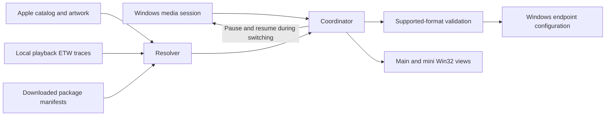

# RateAlign

Windows audio utility that resolves the format reported for the current Apple Music track and adjusts a selected Windows audio endpoint. It combines SMTC media-session information, Apple catalog lookups, local ETW playback telemetry, and downloaded package manifests where available.

**Start:** [Install and run](#install-and-run). **Project contact:** [Pratama Putra](https://github.com/pratama1246); report reproducible problems in [repository issues](https://github.com/pratama1246/AMWin-LosslessSwitcher/issues). See [Privacy](PRIVACY.md), [Terms](TERMS.md), [License](LICENSE), and [code architecture](docs/ARCHITECTURE.md).

This documentation was checked against a local 0.4.0 working copy on 15 November 2026. At that check, committed source was still 0.3.5; the 0.4.0 application changes were not part of this documentation commit. Check the manifest and files in your chosen revision before following version-specific behavior. This does not establish that 0.4.0 binaries are publicly released. RateAlign was previously named RateMatch and LosslessSwitcher. Historical package/storage identifiers remain for compatibility.

## Reader assumptions

Users should understand Windows playback-device selection and Apple Music playback. Developers additionally need Rust/MSVC and Windows SDK tooling. Commands below run in PowerShell from the repository root. SMTC supplies media-session state; ETW supplies local diagnostic telemetry. A reported track format is metadata/telemetry, not an independent measurement of decoded PCM audio.

RateAlign changes endpoint configuration, not the audio samples through its own decoder or encoder. Current switching logic can temporarily pause and resume Apple Music while changing formats, so it should not be described as leaving playback control untouched. Format matching is not a bit-perfect or exclusive-output guarantee.

## Choose a section

- [User and operator procedures](#user-and-operator-procedures)
- [Troubleshooting and escalation](#troubleshooting-and-escalation)
- [Developer procedures](#developer-procedures)
- [Configuration and storage reference](#configuration-and-storage-reference)
- [Dependency reference](#dependency-reference)
- [Architecture explanation](#architecture-explanation)
- [Limitations and compatibility](#limitations-and-compatibility)
- [Acknowledgments and license](#acknowledgments-and-license)

## User and operator procedures

### Install and run

1. On Windows, open the project's [Releases](https://github.com/pratama1246/AMWin-LosslessSwitcher/releases) page and choose an actually available installer or portable asset. Do not infer asset availability from the source version.
2. For an installer, run it and inspect its selected destination/startup options. The source installer uses `PrivilegesRequired=lowest` with an elevation override; do not assume every installation uses one fixed directory.
3. For a portable build, extract it to a writable directory and launch `RateAlign.exe --portable`, or create an empty `portable.dat` beside the executable before launching.
4. In **Settings**, select the intended output device or the Windows-default-device option.
5. In Apple Music, play a test track and compare RateAlign's source/output values and status.

Expected result: the UI identifies the track/output and attempts a supported endpoint format. Other applications using that endpoint may be affected by a format change. Test on an output you control before using a shared listening/production setup.

### Choose a switching mode

1. In **Settings**, select **Seamless Mode** to follow sample rate while retaining a 24-bit output target, or **Purist Mode** to follow both reported rate and depth.
2. Set the settling delay for the test device (UI range 50–800 ms; default setting 300 ms).
3. Play test tracks that exercise different reported formats.
4. Observe the output/status and listen for transition problems.

Expected result: the applied output is supported by the driver. Source/output depth may intentionally differ in Seamless Mode. The mode name does not guarantee an inaudible transition, and switching logic can add adaptive waits beyond the configured delay.

### Use mini mode

1. In the main window, select **Mini mode**.
2. Drag the bar background to position it.
3. Hover the format display to inspect source/output detail.
4. Use the expand control or Escape to return to the main window.

Expected result: the compact 480 × 88 logical-unit bar appears with temporary always-on-top behavior; returning restores the main layout/preference. Mini mode and position are not persisted across restarts.

### Stop switching and recover the output

1. Pause playback in Apple Music before investigating a disruptive transition.
2. Exit RateAlign completely using its exit action; hiding/minimizing to tray is not exit.
3. In Windows sound-device properties, inspect the endpoint format after exit.
4. If it differs from the intended value, restore the approved format in Windows and record the device/driver and observed error for the maintainer.

Expected result: no further RateAlign switching occurs. Normal shutdown attempts to restore captured initial endpoint formats; termination, driver failures, and unavailable devices can prevent restoration. Do not repeatedly force unsupported formats or remove audio drivers to work around an application error.

### Back up preferences

1. Identify whether this instance uses normal or portable storage using [Configuration and storage reference](#configuration-and-storage-reference).
2. Exit the application fully.
3. Copy its active settings/cache directory to a protected backup location.
4. Record the executable version, selected output device, and mode with the backup.

Expected result: preferences and catalog cache can be reviewed/restored with the correct installation context. Do not rename historical storage identifiers without a migration plan.

## Troubleshooting and escalation

| Symptom | User/operator checks | Stop and escalate when |
|---|---|---|
| Idle / waiting for playback | Confirm the intended Apple Music session is playing and not merely showing cached track metadata. | A supported active session is repeatedly missed. |
| Incorrect or delayed source format | Record source/output/status and whether catalog, ETW, or downloaded media is available. | A reproducible track remains mismatched; supply sanitized identifiers, not account data. |
| Limited by device / output unavailable | Confirm endpoint connection, selected device, and supported Windows/driver formats. | The device repeatedly disconnects or format changes fail; consult device support/maintainer. |
| Pops, interruptions, or stuck pause | Pause playback, exit RateAlign, then inspect Windows output state. | Repeated switching affects other audio or restoration fails. Stop automatic use pending review. |
| Settings fail to persist | Check active storage location and write access, including portable directories. | Repair requires deleting/resetting preferences; back them up before maintainer review. |
| Catalog lookup fails | Check network access and whether local telemetry/manifests can resolve the track. | External lookup changes or parser changes require application maintenance. |

Escalation route: device/driver faults go to the device or host owner; reproducible detection/switching/UI faults go to the project contact. Include app revision, Windows/Apple Music version, device/driver, mode/delay, observed status, reproduction steps, and expected/actual behavior. No on-call rota is documented. Do not post account credentials, private diagnostic traces, or unredacted personal listening data in public issues.

## Developer procedures

### Build the executable

Requirements: Windows x64, a stable Rust MSVC toolchain supporting the project's edition-2024 syntax, and MSVC/Windows SDK tools for linking/resources. `Cargo.toml` does not declare an exact minimum Rust version; use the lockfile and verify the chosen toolchain rather than inventing a minimum.

1. In PowerShell, enter the checkout directory (`lossless-switcher-x64` in the reviewed local workspace).
2. Inspect the toolchain with `rustc --version` and `cargo --version`.
3. Run `cargo check --locked`.
4. Run the non-device-focused validation subset: `cargo test --locked --lib --test test_config --test test_storefront`.
5. Build the release executable with `cargo build --release --locked`.

Expected result: checks/tests pass and `target\release\RateAlign.exe` is produced. Inspect test code before broadening the suite: `tests/test_audio.rs` can change the actual default endpoint format, while catalog tests can make network requests. Do not run the full test suite casually on an in-use audio device.

### Build an installer

1. Complete the release executable build above.
2. Review `installer/setup.iss`, including version, build-directory override, startup option, and output destination.
3. With Inno Setup 6 installed, compile that script using its `ISCC.exe` (installation path depends on your machine).
4. Inspect the resulting installer under `dist` and verify it on an appropriate test installation.

Expected result: source 0.4.0 config generates `RateAlign-Setup-v0.4.0.exe`; compilation is not publication. Portable ZIP creation is a separate packaging step, not performed by `cargo build`. See [architecture maintenance guidance](docs/ARCHITECTURE.md) for icon/resource and manual UI validation.

## Configuration and storage reference

| Item | Meaning |
|---|---|
| `mode` | Seamless or Purist target-format selection. |
| `settling_delay_ms` | Saved delay setting; default 300 ms. Adaptive switching waits also apply. |
| `selected_device_id`, `selected_device_name` | Selected endpoint; no selected identifier follows the default output behavior. |
| `is_always_on_top` | Main-window preference; mini mode temporarily changes window behavior. |
| Normal storage | `%APPDATA%\AMWin-LosslessSwitcher`; preferences are `settings.json`. |
| Portable storage | Directory beside executable when `--portable`, `portable.dat`, or a sibling `settings.json` triggers portable selection. Needs write access. |
| `--minimized` / `--tray` | Start minimized to tray. |
| `--portable` | Request executable-relative preferences/cache. |

The current storage initializer also removes the historical `%APPDATA%\LosslessSwitcher-AM` directory if present. Back up any historical preferences before testing an upgrade. This README revision does not execute the initializer. For network/data behavior, see [PRIVACY.md](PRIVACY.md); there is no zero-telemetry claim here.

## Dependency reference

Versions below are read from the current `Cargo.lock`. They are resolved package versions, not evidence of a completed runtime test.

| Package | Locked version |
|---|---|
| `windows` | 0.58.0 |
| `windows-core` | 0.58.0 |
| `serde` | 1.0.229 |
| `serde_json` | 1.0.154 |
| `ureq` | 2.12.1 |
| `embed-resource` | 2.5.2 |

The application uses native Win32 controls and GDI/GDI+ rendering, not Electron or a web frontend. `tracerpt` is used by the local ETW reader; metadata/artwork lookup uses external Apple services. Inno Setup 6 is a packaging tool rather than a Cargo runtime dependency.

## Architecture explanation

The coordinator resolves reported format from media-session metadata, catalog, ETW, and downloaded package manifests, validates a supported endpoint format, and applies it through the Windows audio configuration layer. The UI reads coordinator status. Switching may pause/resume the media session, while shutdown attempts initial-format restoration.

See [docs/ARCHITECTURE.md](docs/ARCHITECTURE.md) for the architecture documentation available in your revision. The local 0.4.0 architecture and release-note edits were outside this documentation commit.

## Limitations and compatibility

Endpoint matching does not bypass the Windows shared audio engine, guarantee exclusive playback, or independently prove bit-perfect audio. System mixing, volume, enhancements, spatial processing, and drivers may still affect output. Available formats depend on the endpoint/driver. Catalog/ETW data can be delayed or ambiguous; no fixed detection-latency guarantee is provided.

The previous README records a maintainer test on Windows 11 with a FiiO JadeAudio JA11, 44.1–192 kHz and 16/24-bit, in both modes. This is historical maintainer-reported evidence, not a test repeated during this documentation revision or a guarantee for other hardware. Screenshots from older versions are historical illustrations, not proof of the current interface.

## Acknowledgments and license

Inspired by [Jordan Gibson's WindowsLosslessSwitcher](https://github.com/jordanmgibson/WindowsLosslessSwitcher) and [Vincent Neo's LosslessSwitcher](https://github.com/vincentneo/LosslessSwitcher). Licensed under [GPL-3.0-only](LICENSE), as declared in `Cargo.toml`. Not affiliated with Apple Inc.; Apple and Apple Music are trademarks of Apple Inc.
